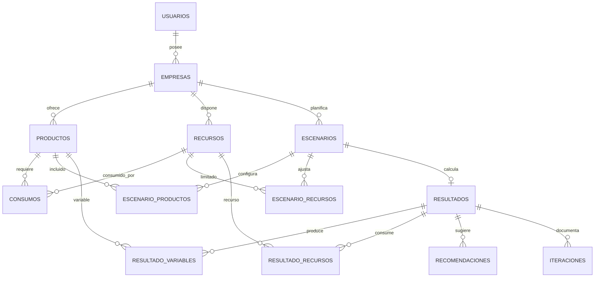

# Diagrama entidad-relación

Las tablas de asociación (`consumos`, `escenario_productos`, `escenario_recursos`, `resultado_variables` y `resultado_recursos`) usan claves primarias compuestas según `database/schema.sql`.

